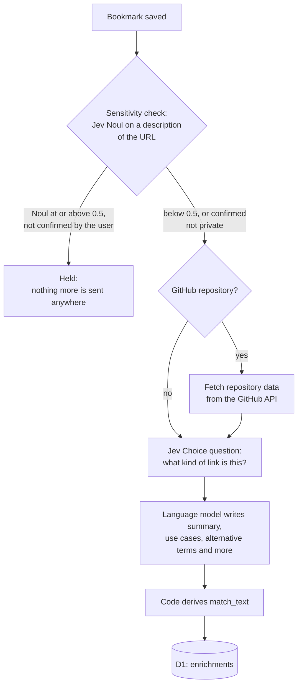

The first search I ran against Haystack in production was "something about a select element". It returned one bookmark, an article titled "A select should tell you something", in a little over half a second. That is the result I wanted. SQLite full-text search, run over the same data, returns nothing for it.

Haystack is a bookmarking tool I am building on Cloudflare Workers and D1. Search is the part of it that matters most to me, because I save links so that I can find them again when I need them, and when I need them I rarely remember the words in the title. I remember the problem I had. This post explains how search works in Haystack today: what Haystack stores for each bookmark, how it decides what may be sent to Jev, the two questions it asks Jev about every bookmark at search time, and what the first day of real searches showed.

> **Note**: Everything here describes Haystack as deployed on November 7, 2026, with Jev model `jev-1.14.0`. The collection is small (14 bookmarks), and every search so far is mine. The findings are a first look, not an evaluation. The evaluation is the next phase of the project, and the end of this post describes what it will measure.

## What Jev Is

[Jev](https://docs.typesafe.ai/) is a model from TypeSafe that answers questions about structured data with probabilities instead of prose. A request sends Jev a JSON `state` and a set of questions about that state, and Jev returns a number for each question. The two question types Haystack uses for search are a [Noul](https://docs.typesafe.ai/primitives/noul.md), which returns the probability that the answer to a yes-or-no question is yes, and a [Score](https://docs.typesafe.ai/primitives/score.md), which places the answer on a set of ordered levels defined in the question.

What I care about is that each answer is a number I can store, compare and threshold in code. Ranking search results needs one number per bookmark, and a model that writes a paragraph about relevance would need another step to turn that paragraph into a number.

## Preparing a Bookmark for Search

Most of what decides search quality happens before anyone types a query. When a bookmark is saved, Haystack enriches it in the background, and the output of that enrichment is a short text field called `match_text`. That field is what Jev reads at search time, and the URL is never part of it.



### The Sensitivity Gate

Some links grant access on their own. A link to a shared document, a password reset link or a signed download URL gives access to whoever has it, and I do not want any of those sent to an external model. Before anything else, Haystack therefore asks Jev one Noul question: would this web address give anyone who has it access to something private?

Jev does not see the URL. It sees a description produced by a function called `describeUrlForJudgment`, which replaces every query value, every fragment value and every path segment that does not read as words with a placeholder such as `<hex:32>` or `<digits:6>`. The page title is included, because "Reset your password" is strong evidence on its own. The question's instructions explain what the placeholders mean, because Jev interprets the question literally and has no other way to learn what they stand for.

A bookmark whose Noul is at or above 0.5 is Held unless I confirm on Haystack's review page that the link is not private. For a Held bookmark, enrichment stops at this step: nothing is sent to GitHub, to the `kind` question or to the language model, and the bookmark is never a search candidate. The same check also runs when I submit the save form, with one attempt and a two-second time limit, so the form can show a warning before the bookmark is saved. A timeout there never blocks saving. The bookmark is saved, and the background enrichment asks the question again, with retries.

### Classifying the Kind of Link

The second Jev question during enrichment is a [Choice](https://docs.typesafe.ai/primitives/choice.md) between eight options: `tool`, `library`, `reference`, `tutorial`, `article`, `discussion`, `collection` and `other`. The options describe what a person does with the link, not where it is hosted, so a GitHub repository for a test runner is a `tool`. `other` is listed last, because TypeSafe's documentation for Jev 1.13 notes that Jev favors the first option when several options fit. The order is unchanged for `jev-1.14.0`.

### What the Language Model Writes

A language model, currently `claude-haiku-5-5` called through Cloudflare AI Gateway, reads what the page and GitHub provided and writes a structured enrichment: a summary of at most 280 characters, use cases, problems solved, technologies, topics and alternative terms. Its output is validated against a schema, and when a response fails validation, the request is retried once.

### Deriving `match_text` in Code

The language model does not write `match_text`. Haystack's code derives it from the stored enrichment, one line per part, in a fixed order. This is the `match_text` for the select article:

```text
A select should tell you something
Kind: article
A blog article arguing that the customizable select element is more than a prettier dropdown, showing with five before/after demos how select options can display information people need to make a decision.
Use when you need to design a select or dropdown whose options show extra details like images or descriptions.
Use when you want to understand what the customizable select element enables beyond styling.
Other terms: customizable select, styled dropdown, custom select menu, select element design, dropdown UX, rich select options
```

Because the text is derived in code, I can change the derivation and regenerate `match_text` for every stored enrichment without calling the language model or Jev again. Version 1 of the derivation leaves out technologies, topics and problems solved, because I expect the use cases to describe a need more directly than a list of topics does. The evaluation phase will test that expectation by comparing search results with and without those fields.

## Deciding What Reaches Jev

A search sends the query and a set of bookmarks to an external service, so most of the search code decides what may be sent, and how much of it in each request.


Haystack manages its feature flags in Flagship, so a flag can change without a deploy. <!-- TODO: link to Flagship and describe it in a few words. --> One flag, `search-enabled`, decides whether the search page exists at all. While the flag is off, `/` redirects to the saved links and the header has no Search link. When the flag cannot be read, Haystack behaves as if it were off. This lets me turn search off without a deploy. The search API itself checks the session, as every route except sign-in does.

The query is then validated against a shared schema: at least one character that is not a space, and at most 500 characters. A query that fails is rejected before anything is read from the database, sent to Jev or written to the log. The limit applies to every channel a search can arrive through, including the agent channels planned for later, because agents can send long queries and the query is included in every request sent to Jev.

The candidates are the bookmarks that have at least one enrichment and are not Held. Search makes the Held decision with the same function that the background enrichment and the review page use, so the three cannot disagree. Every valid query is sent to Jev together with every candidate. There is no keyword filter in front of Jev today, and the section on D1 explains why.

### What Jev Receives

For each bookmark, Jev receives three fields: the title, the kind and the `match_text`. It does not receive the URL, the bookmark's ID or anything else from the row. Each bookmark is named by an alias, `b_0`, `b_1` and so on, and Haystack maps every answer back to the bookmark's ID after the response arrives. The aliases are also shorter than an ID, which keeps each request smaller, because every alias appears in both of the questions asked about its bookmark, which the section after next describes.

### Batches and Token Budgets

Jev's [models page](https://docs.typesafe.ai/models.md) gives two context limits: 32,000 tokens for the state plus any one question, and 64,000 tokens for the whole request. In batched mode, the state holds the query and every bookmark in the request, and every bookmark adds two questions, so both totals grow with the number of bookmarks.

As of November 4, 2026, TypeSafe does not publish a token-counting endpoint or name its tokenizer, so Haystack estimates. It counts one token for every three UTF-8 bytes of the request's JSON, which overestimates the token count of English text, and it keeps 10 percent of each budget unused. A collection that does not fit in one request is split into chunks, and when Jev still rejects a chunk as too long, Haystack splits that chunk in half and sends both halves again.

Every request then waits on a limiter that tracks both requests per second and estimated tokens per second. TypeSafe limits organizations on both, and a few large chunks can use up the token allowance for a second while staying well under the request limit. The whole search has a 20-second deadline, chosen so that the page's 30-second timeout is never reached, even when an attempt is still running at the deadline.

### Pair Mode

Haystack can also send one request per bookmark instead of one per chunk. This is pair mode, and a Flagship flag switches between the two modes without a deploy. Pair mode keeps each request small and independent, but each bookmark counts as a separate request against the rate limit. Batched mode is the default, and whether batching lowers the quality of the results is one of the comparisons in the evaluation phase.

## Two Questions per Bookmark

For every bookmark, Haystack asks two questions about the same query and bookmark. This is the batched form, with one bookmark shown:

```json
{
  "model": "jev-1.14.0",
  "state": {
    "query": "something about a select element",
    "bookmarks": {
      "b_0": {
        "title": "A select should tell you something",
        "kind": "article",
        "match_text": "A select should tell you something\nKind: article\n…"
      }
    }
  },
  "questions": {
    "b_0_helps": {
      "type": "noul",
      "instructions": "Would `bookmarks.b_0` help the person with what `query` describes?",
      "criteria": {
        "true": "The bookmark directly serves the need in the query.",
        "false": "The bookmark is only on a related topic, or unrelated."
      }
    },
    "b_0_relevance": {
      "type": "score",
      "instructions": "How well does `bookmarks.b_0` serve the need described in `query`?",
      "criteria": [
        "Unrelated to the need",
        "Same general area, but would not help with this specific need",
        "Partially addresses the need, or is one of several reasonable options",
        "Directly addresses the need"
      ]
    }
  }
}
```

The two answers are different kinds of number. A Noul of 0.5 means that yes and no are about equally likely, not that the bookmark is half relevant. A Score is the probability-weighted mean of the level numbers, which run from 0 to 3 here. If Jev puts 0.1 on level 0, 0.1 on level 1, 0.2 on level 2 and 0.6 on level 3, the Score is 0 × 0.1 + 1 × 0.1 + 2 × 0.2 + 3 × 0.6 = 2.3.

> **Note**: The Score page warns that different distributions can produce the same score. On these four levels, 1.5 can mean half the probability on level 1 and half on level 2, or half on level 0 and half on level 3. In the second case, Jev is unsure whether the bookmark is unrelated or directly addresses the need, which is a very different answer. For that reason, Haystack stores the four probabilities and Jev's confidence next to the score, so that a later replay can rank by a different number derived from them.

Only one of the two signals ranks the results. Today that is the Score, with a threshold of 1.5, halfway between "same general area, but would not help" and "partially addresses the need". The Noul's threshold, which applies when the Noul is the ranking signal, is 0.5, the point where yes becomes more likely than no. Results at or above the threshold of the ranking signal are shown, highest first. When two results have the same value, the more recently saved bookmark comes first, followed by the lower ID, so that the order never depends on the order in which chunks came back.

Asking both questions means two questions per bookmark instead of one, which uses more of the token budget and therefore more request capacity. Haystack asks both for now so that every search records both signals. The evaluation phase can then choose between them using real data instead of my expectations.

## Logging Every Answer

Every search that passes validation is logged, whatever its outcome, in two D1 tables. `search_runs` has one row per search: the query, whether it was typed or spoken, the request mode, the Jev model, both thresholds, the input tokens Jev reported, the latency and the outcome. `search_answers` has one row per bookmark per search, with the Noul, the Score, the Score's probabilities and confidence, whether the result was shown, and whether I followed it.

Because both signals and both thresholds are stored for every answer, any past search can be replayed with a different signal or threshold without calling Jev again. That is the purpose of the logging, and it is also how I found the threshold problem described below.

## Early Findings

These are the numbers from the first evening, 11 searches against 14 bookmarks, read directly from the two tables.

| Measure                 | Value                               |
| ----------------------- | ----------------------------------- |
| Searches                | 11, all with the outcome `ok`       |
| Input mode              | 10 typed, 1 spoken                  |
| Latency                 | 500 to 620 ms                       |
| Input tokens per search | About 4,745, in one batched request |

Each search sends all 14 bookmarks, so the token count, and the cost, grows with the collection. The 4,745 tokens include the query as well as each bookmark and both of its questions, so dividing by 14 gives only a rough cost per bookmark. Dividing Jev's 32,000-token limit by about 340 tokens per bookmark gives roughly 94, so a single request is no longer enough at somewhere around a hundred bookmarks. Haystack's own estimate is conservative, so in practice it will start splitting searches into several requests earlier than that.

### What Worked

The select queries found the select article every time, with Scores between 2.80 and 2.98. That includes "Uh select element", which the browser's speech recognition transcribed with my hesitation at the start. The filler word made no difference to the result.

"web guidance" showed Modern Web Guidance first, followed by several bookmarks about WebMCP, a proposal for exposing tools on web pages to AI agents. "web guidance not mcp" showed only Modern Web Guidance. Jev treated "not mcp" as an instruction about the need, not as two more words to match.

### Where the Starting Threshold Lets Weak Results Through

The Score threshold of 1.5 shows some results that the Noul says will not help:

| Query                | Result shown                                    | Score | Noul |
| -------------------- | ----------------------------------------------- | ----- | ---- |
| web guidance         | A select should tell you something              | 1.50  | 0.33 |
| topics related to ai | perplexityai/bumblebee                          | 1.51  | 0.28 |
| guidance             | Example Agentic Chrome Extension to test WebMCP | 1.53  | 0.31 |
| guidance             | WebMCP - Chrome for Developers                  | 1.60  | 0.35 |

The first row had a visible effect. I searched for "web guidance" twice. The first search showed four results and the second showed five, because the select article scored 1.45 the first time and 1.50 the second. A small variation in Jev's answer decided whether a result appeared at all. Ranking by the Noul with its 0.5 threshold would have removed every row in this table, and so would a higher Score threshold. Choosing between those two options is now a decision based on logged evidence rather than on my expectations.

## What Jev Adds Over D1 Alone

D1 [supports SQLite's FTS5 module](https://developers.cloudflare.com/d1/sql-api/sql-statements/) for full-text search, so a fair question is whether Haystack needs Jev at all. To answer it with data, I loaded the production export into a local SQLite database, built an FTS5 table over the same `title` and `match_text` that Jev reads, and ran the same queries.

```sql
CREATE VIRTUAL TABLE bookmark_search USING fts5(
  bookmark_id UNINDEXED,
  title,
  match_text,
  tokenize = 'porter unicode61'
);

INSERT INTO bookmark_search
SELECT bookmarks.id, bookmarks.title, enrichments.match_text
FROM bookmarks
JOIN enrichments ON enrichments.bookmark_id = bookmarks.id;

SELECT title, bm25(bookmark_search)
FROM bookmark_search
WHERE bookmark_search MATCH 'something about a select element'
ORDER BY bm25(bookmark_search);
```

> **Note**: I ran this with the SQLite 3.54.0 that ships with macOS, not on D1 itself, and with the Porter stemming tokenizer. I expect D1's FTS5 to behave the same way for these queries, but I have not run them on D1. A [trigram index](https://www.sqlite.org/fts5.html#the_trigram_tokenizer) would change two rows of the table below. It matches any run of three or more characters, so `NOT mcp` would also exclude webmcp-skills, and a query term shorter than three characters, such as "Uh", places no constraint on the match, so "Uh select element" would find the select article. The first row would still fail, because "about" does not appear in the stored text, and a query for `ai` would match nothing, because the term is shorter than three characters. I checked this trigram behavior with a small test table in SQLite 3.53.1, not against the production export.

| Query                            | FTS5                                  | Jev                         |
| -------------------------------- | ------------------------------------- | --------------------------- |
| something about a select element | No results                            | The select article          |
| Uh select element                | No results                            | The select article          |
| select element                   | The select article                    | The select article          |
| topics related to ai             | No results                            | 11 results, AI topics first |
| web guidance NOT mcp             | Modern Web Guidance and webmcp-skills | Modern Web Guidance only    |

The first two rows fail because FTS5 treats every word in the query as required by default, and the stored text does not contain words such as "about" or "Uh". The third row succeeds once I remove the words the index does not have. Doing that automatically means writing a query parser that removes filler words, decides which terms are optional and rewrites a sentence into `select OR element`. That parser would have to guess which words are meaningful, and the person searching would have to learn how it guesses.

The "ai" query shows a second difference. Searching FTS5 for the single token `ai` matches seven bookmarks, because the token appears in the title or `match_text` of seven bookmarks. It misses "Defeating Nondeterminism in LLM Inference", "Introducing Clairic" and "Getting the most out of Opus 5.5", which are about AI but never use the token. It also misses `perplexityai/bumblebee`, because the tokenizer reads "perplexityai" as one word. Jev showed the first three, because it judges whether a bookmark is about the topic, not whether the text contains the token. It also showed `perplexityai/bumblebee`, but that is the 1.51 result from the threshold table: the Score let it through even though the Noul of 0.28 said it would not help.

The last row shows the difference most clearly. FTS5 supports `NOT`, but `web guidance NOT mcp` still returns webmcp-skills, because the index contains the token `webmcp`, which is not the token `mcp`. Jev treated a bookmark about WebMCP as a bookmark about MCP.

Full-text search answers the question "which bookmarks contain these words?". The question I ask when I search my bookmarks is "which bookmark helps with what I am trying to do?". Jev answers the second question directly, with a probability per bookmark that Haystack can rank, threshold, log and replay. Getting the same behavior from D1 alone would mean writing a query-understanding layer on top of FTS5, and that layer would be a less capable version of what Jev already does.

FTS5 has clear advantages. It runs inside D1 with no external request, no token cost and no rate limit, and its latency does not depend on an external service's load. As the collection grows, sending every bookmark to Jev on every search will not scale, and at that point a cheap first pass that selects candidates becomes necessary. The project plan defers that shortlisting step. When it arrives, it is more likely to use embeddings with [Cloudflare Vectorize](https://developers.cloudflare.com/vectorize/) than FTS5, because the failures above are failures of exact matching, and an FTS5 shortlist would exclude the same bookmarks before Jev ever saw them.

## What Comes Next

The next phase of the project is the evaluation. I will write a labeled set of queries, with the bookmarks that should and should not match each one, and use the logs to replay every search under different signals and thresholds without calling Jev again. The evaluation will compare the Noul with the Score as the ranking signal, and batched mode with pair mode. It will also measure how latency grows with collection size and when shortlisting becomes necessary, and test whether adding technologies, topics and problems solved to `match_text` improves the results. Each of the choices being compared is already a Flagship flag, so applying the result does not need a deploy.

## Wrapping Up

Haystack searches by need, not by words, because Jev answers the question "would this bookmark help with this query?" with a probability per bookmark. Most of the work around that question decides what may be sent to Jev: a sensitivity check that keeps links that grant access on their own away from every external service, a `match_text` field derived in code so that the URL is never sent, and token budgets and a rate limiter that keep each search within Jev's limits.

The trap I hit was in my own starting values. A Score threshold of 1.5 looked reasonable when I chose it. The first evening of searches showed results at 1.50 and 1.51 that the Noul had already rejected, and one query that returned a different number of results on each of its two runs. I found the problem only because Haystack logs both signals for every search. If you build something similar, log the numbers you are not using yet. They can show you when the numbers you are using are wrong.

## Further Reading

- [TypeSafe's System One API reference](https://docs.typesafe.ai/api/system-one.md), which defines the request's `model`, `state` and `questions` fields.
- [The Noul primitive](https://docs.typesafe.ai/primitives/noul.md), for what the probability means and how `criteria` works.
- [The Score primitive](https://docs.typesafe.ai/primitives/score.md), which is worth reading twice: it explains why two different distributions can give the same score.
- [Jev's models page](https://docs.typesafe.ai/models.md), for the two context limits that decide how many bookmarks fit in one request.
- [D1's SQL statements page](https://developers.cloudflare.com/d1/sql-api/sql-statements/), which lists FTS5 among the supported SQLite extensions and notes that exports do not include virtual tables.
- [SQLite's FTS5 documentation](https://www.sqlite.org/fts5.html), for the query syntax, the tokenizers and the `bm25()` ranking function used in the comparison.
