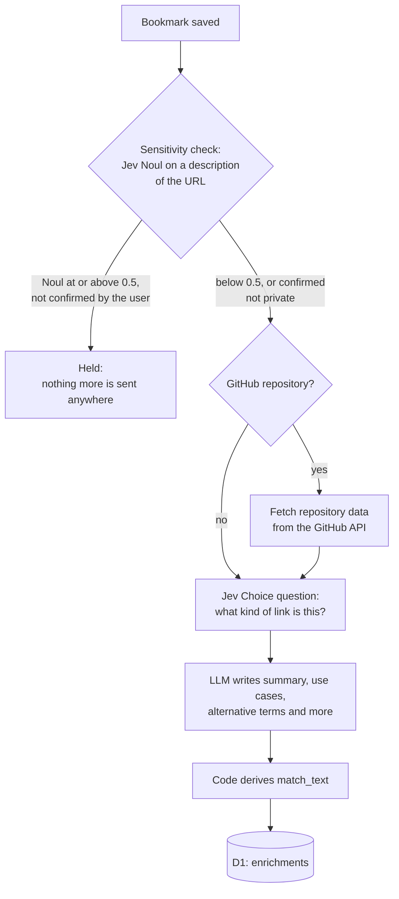
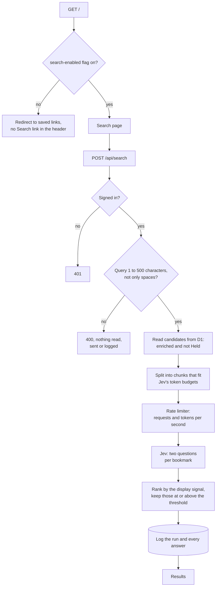

The first search I ran against Haystack in production was "something about a select element". It returned one bookmark, an article titled "A select should tell you something", in a little over half a second. That is the result I wanted, and it is also a query that SQLite full-text search, run over the same data, answers with nothing at all.

Haystack is a bookmarking tool I am building on Cloudflare Workers and D1. Search is the part of it that matters most to me, because I save links so that I can find them again when I need them, and when I need them I rarely remember the words in the title. I remember the problem I had. This post explains how search works in Haystack today: what we store for each bookmark, how we decide what is allowed to reach Jev, the two questions we ask about every bookmark, and what the first day of real searches showed.

> **Note**: Everything here describes Haystack as deployed on November 7, 2026, with Jev model `jev-1.14.0`. The collection is small, 14 bookmarks, and every search so far is mine. The findings are a first look, not an evaluation. The evaluation is the next phase of the project, and I describe what it will measure near the end of the post.

## What Jev Is

[Jev](https://docs.typesafe.ai/) is a model from TypeSafe that answers questions about structured data with probabilities instead of prose. We send it a JSON `state` and a set of questions about that state, and for each question it returns a number. The two question types Haystack uses for search are a [Noul](https://docs.typesafe.ai/primitives/noul.md), which returns the probability that the answer to a yes-or-no question is yes, and a [Score](https://docs.typesafe.ai/primitives/score.md), which places the answer on a set of ordered levels that we define.

The property I care about is that the answer is a number we can store, compare and threshold in code. Search ranking needs a number per bookmark. A model that writes a paragraph about relevance would need another step to turn that paragraph into one.

## Preparing a Bookmark for Search

Search quality is decided long before anyone types a query. When a bookmark is saved, Haystack enriches it in the background, and the output of that enrichment is a short text field called `match_text`. That field is what Jev reads at search time. The URL is never part of it.



### The Sensitivity Gate

Some links are keys. A shared document, a password reset link or a signed download URL gives access to whoever holds it, and I do not want any of those sent to an external model. So before anything else, Haystack asks Jev one Noul question: would this web address give anyone who has it access to something private?

Jev does not see the URL. It sees a description produced by a function called `describeUrlForJudgment`, which replaces every query value, every fragment value and every path segment that does not read as words with a placeholder such as `<hex:32>` or `<digits:6>`. The page title is included, because "Reset your password" is strong evidence on its own. The question's instructions explain what the placeholders mean, because Jev reads the question literally and has no other way to know.

A bookmark whose Noul is at or above 0.5 is Held unless I confirm that the link is not private. For a Held bookmark, the enrichment stops at this step: nothing is sent to GitHub, to the `kind` question or to the language model, and the bookmark is never a search candidate. The same check also runs on the save form itself, with one attempt and a two second time limit, so the form can show a warning before I save. A timeout there never blocks saving: the bookmark is saved, and the background enrichment asks again with retries.

### What Kind of Link Is It

The second Jev question is a [Choice](https://docs.typesafe.ai/primitives/choice.md) between eight options: `tool`, `library`, `reference`, `tutorial`, `article`, `discussion`, `collection` and `other`. The options describe what a person does with the link, not where it is hosted, so a GitHub repository for a test runner is a `tool`. `other` is the last option, because TypeSafe's documentation for Jev 1.13 notes that Jev leans towards the first option when options compete.

### The Language Model's Part

A language model, currently `claude-haiku-5-5` called through Cloudflare AI Gateway, reads what the page and GitHub provided and writes a structured enrichment: a summary of at most 280 characters, use cases, problems solved, technologies, topics and alternative terms. Its output is validated against a schema, and a response that fails validation is retried once.

### Deriving `match_text` in Code

The language model does not write `match_text`. Our code derives it from the stored enrichment, one line per part, in a fixed order. This is the `match_text` for the select article:

```text
A select should tell you something
Kind: article
A blog article arguing that the customizable select element is more than a prettier dropdown, showing with five before/after demos how select options can display information people need to make a decision.
Use when you need to design a select or dropdown whose options show extra details like images or descriptions.
Use when you want to understand what the customizable select element enables beyond styling.
Other terms: customizable select, styled dropdown, custom select menu, select element design, dropdown UX, rich select options
```

Deriving the text in code means we can change the derivation and apply it to every stored enrichment again without calling the language model or Jev. Version 1 leaves out technologies, topics and problems solved, because I expect the use cases to describe a need more directly than a list of topics does. That expectation is something the evaluation phase will test, by comparing search results with and without those fields.

## Deciding What Reaches Jev

A search sends the query and a set of bookmarks to an external service, so most of the search code is about deciding what is allowed to go, and how much of it at once.



A Flagship feature flag, `search-enabled`, decides whether the search page exists at all. While it is off, `/` redirects to the saved links and the header has no Search link, and when the flag cannot be read, the page behaves as if it were off. This lets me turn search off without a deploy. The search API itself checks the session, as every route except sign-in does.

The query is then validated against a shared schema: at least one character that is not a space, and at most 500 characters. A query that fails is rejected before anything is read from the database, sent to Jev or written to the log. The limit applies to every channel, including the agent channels planned for later, because agents can send long queries and the query is repeated in every request.

The candidates are the bookmarks that have at least one enrichment and are not Held. The Held decision is made by the same function that the background enrichment and the review page use, so the three cannot disagree. Every valid query is sent to Jev with every candidate. There is no keyword filter in front of Jev today, and I come back to why in the section on D1.

### What Jev Receives

For each bookmark, Jev receives three fields: the title, the kind and the `match_text`. It does not receive the URL, the bookmark's ID or anything else from the row. Each bookmark is named by an alias, `b_0`, `b_1` and so on, and our code maps every answer back to the bookmark's ID after the response arrives. The aliases are also shorter than an ID, which matters because each alias appears in both of its bookmark's questions.
