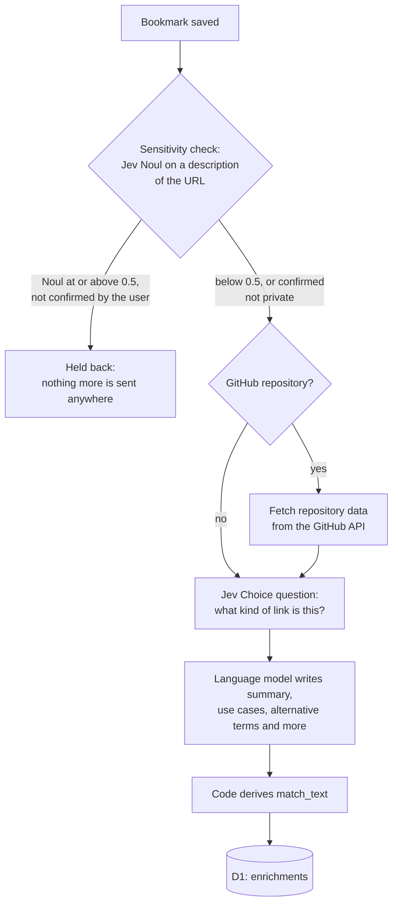
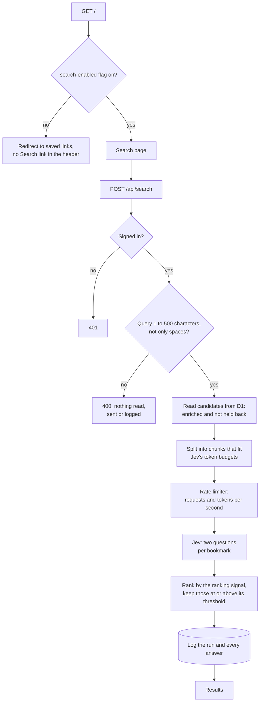

The first search I ran against Haystack in production was "something about a select element". It returned one bookmark, an article titled "A select should tell you something", in a little over half a second. That is the result I wanted. SQLite full-text search, run over the same data, returns nothing for it.

Haystack is a bookmarking tool I am building on Cloudflare Workers and D1. Search is the part that matters most to me, and the part where I want to experiment. I save links so that I can find them again (obviously), but a lot of time can pass between saving a link and needing it. By then, I often no longer remember the title, who wrote it or the website. What I remember is the topic, or the general idea. For example, I might remember an article about controlling GIF playback with CSS, and search for "pause GIF playback with CSS" or "controlling GIF playback with CSS". I might even type "controlling GIF playback without JavaScript".

Full-text search gets part of the way there, and the section on D1 shows where it stops with my bookmarks. I wanted to try a different approach: enrich each link's metadata with AI when it is saved, and then ask a decision model such as Jev to find the link again later. This post explains how search works in Haystack today: what it stores for each bookmark, what it may send to Jev, the two questions it asks Jev for each bookmark when I search, and what the first day of real searches showed.

> **Note**: Everything here describes Haystack as deployed on November 7, 2026, with `jev-1.14.0`. The findings are a first look, not an evaluation. The evaluation is the next phase of the project. More on that at the end of the post.

## What Jev Is

[Jev](https://docs.typesafe.ai/introduction) is a model from TypeSafe AI, and its documentation sums it up in one line: "Send state and typed questions; get structured answers your code can use directly." Jev does not generate text. I send it a JSON `state` and questions about that state, and it returns a typed answer to each, along with the probabilities behind it. For search, I use two of its question types: a [Noul](https://docs.typesafe.ai/primitives/noul.md), which returns the probability that the answer to a yes-or-no question is yes, and a [Score](https://docs.typesafe.ai/primitives/score.md), which places the answer on ordered levels that I define.

Structured answers my code can use directly are what I care about. For both question types, the answer is a number I can store, compare and set a threshold on in code. Ranking needs one number per bookmark, and a model that writes a paragraph about relevance would need an extra step to turn that paragraph into one.

## Preparing a Bookmark for Search

Most of what decides search quality happens before I type a query. When I save a bookmark, Haystack enriches it in the background and produces a short text field called `match_text`. Jev reads that field when I search, and the URL is never part of it.



### The Sensitivity Gate

Haystack is careful with links that might be sensitive, and checks for them in two steps. First, a function called `detectSensitiveUrl` recognizes addresses that contain an access token, a user name and password, or a signed storage access key. Haystack refuses to save those, and the browser extension refuses them before the address leaves the browser. A private share, though, can look like any other address. So for every link that passes the first step, Haystack asks Jev one Noul question before anything else: would this web address give anyone who has it access to something private?

Asking it directly would mean sending Jev the URL, which is exactly what I want to avoid. Instead, the request contains a description of the URL from a function called `describeUrlForJudgment`. It keeps the scheme, the host and the names of any query and fragment parameters, and replaces every parameter value, and every path segment that does not read as words, with a placeholder such as `<hex:32>` or `<digits:6>`. I also include the page title, because "Reset your password" is strong evidence on its own. The question's instructions explain the placeholders, because Jev takes a question's wording literally and nothing else in the request explains them.

If Jev's answer is 0.5 or higher, Haystack holds the bookmark back until I confirm that the link is not private. A held-back bookmark goes no further: Haystack does not request repository details from the GitHub API, ask the `kind` question or send anything to the language model, and the bookmark never appears in a search. The "Links to review" page at `/held` lists held-back bookmarks and lets me release, retry or delete each one.

I save links with the browser extension or by pasting an address into the "Save a link" form on my saved links page. Both lead to the same save form at `/save`, which asks Jev the same question when it opens and again when I press Save. If the answer is 0.5 or higher, the form warns me and shows a required checkbox, "This link does not give access to anything private". Ticking it is the confirmation, so the bookmark is not held back.

Because I am waiting on the form, this check gets one attempt and a two-second time limit. If Jev does not answer in time, the form shows no warning and saving works as usual, so a slow or unavailable Jev never stops me from saving. Haystack then asks again right after saving, before it sends anything about the link to the services that describe it, and again in a later run, with retries, if needed. The rest of the enrichment, including the language model's description, runs after the "Saved" page appears, so I never wait on it.

### Classifying the Kind of Link

The second enrichment question asks Jev what kind of link this is. It is a [Choice](https://docs.typesafe.ai/primitives/choice.md) between eight options: `tool`, `library`, `reference`, `tutorial`, `article`, `discussion`, `collection` and `other`. The options describe what I do with the link, not where it is hosted, so a GitHub repository for a test runner is a `tool`. I put `other` last, because TypeSafe AI's [model jaggedness page](https://docs.typesafe.ai/model-jaggedness.md#choice-option-order) notes that option order can affect the answer, with Jev leaning toward the first option.

### What the Language Model Writes

For the rest of the enrichment, I use a language model, currently `claude-haiku-5-5` called through Cloudflare AI Gateway. It reads what the page and GitHub provided and writes a structured enrichment: a summary of at most 280 characters, use cases, problems solved, technologies, topics and alternative terms. Haystack validates the output against a schema and retries the request once if validation fails.

### Deriving `match_text` in Code

I do not let the language model write `match_text`. Haystack derives it in code from the stored enrichment, one line per part, in a fixed order. This is the `match_text` for the select article:

```text
A select should tell you something
Kind: article
A blog article arguing that the customizable select element is more than a prettier dropdown, showing with five before/after demos how select options can display information people need to make a decision.
Use when you need to design a select or dropdown whose options show extra details like images or descriptions.
Use when you want to understand what the customizable select element enables beyond styling.
Other terms: customizable select, styled dropdown, custom select menu, select element design, dropdown UX, rich select options
```

Deriving it in code leaves me room to change my mind: I can change the derivation and regenerate `match_text` for every stored enrichment without calling the language model or Jev. Version 1 of the derivation leaves out technologies, topics and problems solved. I expect the use cases to describe a need more directly than a list of topics does, but that is an expectation, not a finding, and the evaluation phase will test it by comparing results with and without those fields.

## Deciding What Reaches Jev

Every search sends my query and some of my bookmarks to an external service. That made me careful: most of the search code decides what may be sent, and how much goes in each request.



I manage Haystack's feature flags in [Flagship](https://developers.cloudflare.com/flagship/), Cloudflare's feature flag service for Workers, which has been in public beta since May 26, 2026. The Worker reads them through a binding, so I can change a flag without a deploy. One flag, `search-enabled`, decides whether the search page exists at all. While it is off, `/` redirects to my saved links and the header has no Search link. When the flag cannot be read, Haystack behaves as if it were off, so a problem with Flagship never turns search on by accident. The search API itself checks the session, as every route except sign-in does.

Haystack then validates the query against a shared schema: at least one character that is not a space, and at most 500 characters. A query that fails is rejected before anything is read from the database, sent to Jev or logged. The same limit applies to every channel a search can arrive through, including the agent channels I plan to add, because agents can send long queries and the query is part of every request to Jev.

The candidates are the bookmarks that have at least one enrichment and are not held back. I wanted exactly one answer to "is this bookmark held back?", so search, the background enrichment and the "Links to review" page all use the same function and cannot disagree. Today, every valid query goes to Jev with every candidate. There is no keyword filter in front of Jev, and the section on D1 explains why.

### What Jev Receives

For each bookmark, Jev receives three fields: the title, the kind and the `match_text`. Nothing else from the row is sent, not the URL and not the bookmark's ID. Each bookmark gets an alias, `b_0`, `b_1` and so on, and Haystack maps every answer back to the bookmark's ID. Aliases are also shorter than IDs, which matters because each alias appears in both questions about its bookmark (shown under "Two Questions per Bookmark"), so shorter aliases keep each request smaller.

### Batches and Token Budgets

Jev's [models page](https://docs.typesafe.ai/models.md#context-length) gives two context limits: 32k tokens for the state plus any one question, and 64k tokens for the whole request. I read those as 32,000 and 64,000, the more conservative reading. A long-context header raises both limits, but the same page says it is slower and less accurate, so Haystack does not send it. In batched mode, the state holds the query and every bookmark in the request, and every bookmark adds two questions, so both totals grow as my collection grows.

I would have liked to count tokens exactly, but as of November 4, 2026, TypeSafe does not publish a token-counting endpoint or name its tokenizer, so Haystack estimates: one token for every three UTF-8 bytes of the request's JSON, which overestimates the token count of English text, with 10 percent of each budget kept unused. I would rather send one request too many than have Jev reject one. A collection that does not fit in one request is split into chunks, and if Jev still rejects a chunk as too long, Haystack splits it in half and sends both halves.

Every request then waits on a limiter that tracks requests and estimated tokens per second. TypeSafe limits organizations on both, and a few large chunks can use up a second's token allowance while staying well under the request limit. I gave the whole search a 20-second deadline, so the page's 30-second timeout is never reached, even when an attempt is still running at the deadline.

### Pair Mode

Haystack can also send one request per bookmark instead of one per chunk. I call this pair mode, and a Flagship flag switches between the two modes. Pair mode keeps each request small and independent, but each bookmark counts as a separate request against the rate limit. Batched mode is the default. I do not know yet whether batching lowers the quality of the results, and the evaluation phase will compare the two.

## Two Questions per Bookmark

For every bookmark, I ask Jev two questions about how well it matches the query. Here is the batched form, with one bookmark shown:

```json
{
  "model": "jev-1.14.0",
  "state": {
    "query": "something about a select element",
    "bookmarks": {
      "b_0": {
        "title": "A select should tell you something",
        "kind": "article",
        "match_text": "A select should tell you something\nKind: article\n…"
      }
    }
  },
  "questions": {
    "b_0_helps": {
      "type": "noul",
      "instructions": "Would `bookmarks.b_0` help the person with what `query` describes?",
      "criteria": {
        "true": "The bookmark directly serves the need in the query.",
        "false": "The bookmark is only on a related topic, or unrelated."
      }
    },
    "b_0_relevance": {
      "type": "score",
      "instructions": "How well does `bookmarks.b_0` serve the need described in `query`?",
      "criteria": [
        "Unrelated to the need",
        "Same general area, but would not help with this specific need",
        "Partially addresses the need, or is one of several reasonable options",
        "Directly addresses the need"
      ]
    }
  }
}
```

The two answers look similar, but they are different kinds of number. A Noul of 0.5 means that yes and no are about equally likely, not that the bookmark is half relevant. A Score is the probability-weighted mean of the level numbers, which run from 0 to 3 here. If Jev puts 0.1 on level 0, 0.1 on level 1, 0.2 on level 2 and 0.6 on level 3, the Score is 0 × 0.1 + 1 × 0.1 + 2 × 0.2 + 3 × 0.6 = 2.3.

> **Note**: The Score page warns that different distributions can produce the same score. On these four levels, 1.5 can mean half the probability on level 1 and half on level 2, or half on level 0 and half on level 3. In the second case, Jev is unsure whether the bookmark is unrelated or directly addresses the need, which is a very different answer. That is why I store the four probabilities and Jev's confidence next to the score, so a later replay can rank by a different number derived from them.

Only one signal ranks the results. Today that is the Score, with a threshold of 1.5, halfway between "same general area, but would not help" and "partially addresses the need". If I switch to the Noul, its threshold is 0.5, where yes becomes more likely than no. Results at or above the threshold are shown, highest first. A tie goes to the more recently saved bookmark, then to the lower ID, so the order is the same every time, whatever order the chunks came back in.

Asking both doubles the questions per bookmark, which uses more of the token budget and therefore more request capacity. I ask both for now because I do not yet know which signal is better, and I would rather decide from real data than from expectations. Every search records both, and the evaluation phase will choose.

## Logging Every Answer

I log every search that passes validation, whatever its outcome, in two D1 tables. `search_runs` has one row per search: the query, whether it was typed or spoken, the request mode, the Jev model, both thresholds, the input tokens Jev reported, the latency and the outcome. `search_answers` has one row per bookmark per search, with the Noul, the Score, the Score's probabilities and confidence, whether the result was shown, and whether I followed it.

With both signals and both thresholds stored for every answer, I can replay any past search with a different signal or threshold without calling Jev. That is why I log this much, and it is how I found the threshold problem below.

## Early Findings

These are the numbers from the first evening: 11 searches against 14 bookmarks, all of them mine, read directly from the two tables.

| Measure                 | Value                               |
| ----------------------- | ----------------------------------- |
| Searches                | 11, all with the outcome `ok`       |
| Input mode              | 10 typed, 1 spoken                  |
| Latency                 | 500 to 620 ms                       |
| Input tokens per search | About 4,745, in one batched request |

Each search sends all 14 bookmarks, so the token count, and the cost, grows with my collection. The 4,745 tokens include the query as well as each bookmark and its two questions, so dividing by 14, which gives about 340 tokens per bookmark, is only rough. Dividing the 32,000-token limit by 340 gives roughly 94, so one request stops being enough at around a hundred bookmarks. Because Haystack's estimate is conservative, it will start splitting searches earlier than that.

### What Worked

The select queries found the select article every time, with Scores between 2.80 and 2.98. My favorite is "Uh select element", which the browser's speech recognition transcribed complete with my hesitation at the start. The filler word made no difference to the result.

Searching for "web guidance" showed Modern Web Guidance first, followed by several bookmarks about WebMCP, a proposal for exposing tools on web pages to AI agents. When I tried "web guidance not mcp", it showed only Modern Web Guidance. Jev treated "not mcp" as an instruction about the need, not as two more words to match.

### Where the Starting Threshold Lets Weak Results Through

Not everything went the way I hoped. The Score threshold of 1.5 shows some results that the Noul says will not help:

| Query                | Result shown                                    | Score | Noul |
| -------------------- | ----------------------------------------------- | ----- | ---- |
| web guidance         | A select should tell you something              | 1.50  | 0.33 |
| topics related to ai | perplexityai/bumblebee                          | 1.51  | 0.28 |
| guidance             | Example Agentic Chrome Extension to test WebMCP | 1.53  | 0.31 |
| guidance             | WebMCP - Chrome for Developers                  | 1.60  | 0.35 |

The first row had a visible effect. I searched for "web guidance" twice: the first search showed four results and the second five, because the select article scored 1.45 the first time and 1.50 the second. A small variation in Jev's answer decided whether a result appeared at all. Ranking by the Noul with its 0.5 threshold would have removed every row in this table, and so would a higher Score threshold. I do not have to guess which to choose: the logs hold both answers for every search.

## What Jev Adds Over D1 Alone

D1 [supports SQLite's FTS5 module](https://developers.cloudflare.com/d1/sql-api/sql-statements/) for full-text search, so I asked myself whether Haystack needs Jev at all. To answer with data rather than opinion, I loaded the production export into a local SQLite database, built an FTS5 table over the same `title` and `match_text` that Jev reads, and ran the same queries.

```sql
CREATE VIRTUAL TABLE bookmark_search USING fts5(
  bookmark_id UNINDEXED,
  title,
  match_text,
  tokenize = 'porter unicode61'
);

INSERT INTO bookmark_search
SELECT bookmarks.id, bookmarks.title, enrichments.match_text
FROM bookmarks
JOIN enrichments ON enrichments.bookmark_id = bookmarks.id;

SELECT title, bm25(bookmark_search)
FROM bookmark_search
WHERE bookmark_search MATCH 'something about a select element'
ORDER BY bm25(bookmark_search);
```

> **Note**: I ran this with the SQLite 3.54.0 that ships with macOS and the Porter stemming tokenizer, not on D1 itself. I expect D1's FTS5 to behave the same way, but I have not checked. A [trigram index](https://www.sqlite.org/fts5.html#the_trigram_tokenizer) would change two rows of the table below. It matches any run of three or more characters, so `NOT mcp` would also exclude webmcp-skills, and a term shorter than three characters, such as "Uh", does not restrict the match, so "Uh select element" would find the select article. The first row would still fail, because "about" is not in the stored text, and `ai` on its own would match nothing, because it is shorter than three characters. I checked the trigram behavior with a small test table in SQLite 3.53.1, not against the production export.

| Query                            | FTS5                                  | Jev                         |
| -------------------------------- | ------------------------------------- | --------------------------- |
| something about a select element | No results                            | The select article          |
| Uh select element                | No results                            | The select article          |
| select element                   | The select article                    | The select article          |
| topics related to ai             | No results                            | 11 results, AI topics first |
| web guidance NOT mcp             | Modern Web Guidance and webmcp-skills | Modern Web Guidance only    |

The first two rows fail because FTS5 treats every word in the query as required by default, and the stored text does not contain words such as "about" or "Uh". The third row succeeds once I remove the words the index does not have. I could automate that with a query parser that removes filler words, decides which terms are optional and rewrites a sentence into `select OR element`. That parser would have to guess which words are meaningful, and I would have to learn how it guesses before I could trust it.

The "ai" query shows a second difference. Searching FTS5 for the single token `ai` matches the seven bookmarks whose title or `match_text` contains it. It misses "Defeating Nondeterminism in LLM Inference", "Introducing Clairic" and "Getting the most out of Opus 5.5", which are about AI but never use the token. It also misses `perplexityai/bumblebee`, because the tokenizer reads "perplexityai" as one word. Jev showed the first three, because it judges whether a bookmark is about the topic, not whether the text contains the token. It also showed `perplexityai/bumblebee`, but that is the 1.51 result from the threshold table: the Score let it through even though the Noul of 0.28 said it would not help.

The last row shows the difference most clearly. FTS5 supports `NOT`, but `web guidance NOT mcp` still returns webmcp-skills, because the index contains the token `webmcp`, which is not the token `mcp`. Jev treated a bookmark about WebMCP as a bookmark about MCP.

Full-text search answers the question "which bookmarks contain these words?". When I search, the question I am really asking is "which bookmark helps with what I am trying to do?". Jev answers that second question directly, with a probability per bookmark that I can rank, threshold, log and replay. Getting the same behavior from D1 alone would mean writing a query-understanding layer on top of FTS5, and I would end up with a less capable version of what Jev already does.

None of this makes FTS5 the wrong tool. It runs inside D1 with no external request, no token cost and no rate limit, and its latency does not depend on an external service's load. As my collection grows, sending every bookmark to Jev on every search will not scale, and at some point I will need a cheap first pass that selects candidates. The project plan defers that shortlisting step. When I get to it, I am more likely to use embeddings with [Cloudflare Vectorize](https://developers.cloudflare.com/vectorize/) than FTS5. The failures above are failures of exact matching, and an FTS5 shortlist would exclude the same bookmarks before Jev ever saw them.

## What Comes Next

Next up is the evaluation. I will write a labeled set of queries, with the bookmarks that should and should not match each one, and use the logs to replay every search under different signals and thresholds without calling Jev. The evaluation will compare the Noul with the Score as the ranking signal, and batched mode with pair mode. It will also measure how latency grows with collection size and when shortlisting becomes necessary, and test whether adding technologies, topics and problems solved to `match_text` improves the results. Each choice being compared is already a Flagship flag, so acting on the results will not need a deploy.

## Wrapping Up

Haystack searches by need, not by words, because Jev answers the question "would this bookmark help with this query?" with a probability per bookmark. Much of what I built around that question decides what may be sent to Jev: a two-step sensitivity check that keeps links that might work like a key away from the services that describe them, a `match_text` field derived in code so that the URL is never sent, and token budgets and a rate limiter that keep each search within Jev's limits.

The trap I fell into was my own starting values. A Score threshold of 1.5 looked reasonable when I chose it. Then the first evening of searches showed results at 1.50 and 1.51 that the Noul had already rejected, and one query that returned a different number of results on each of its two runs. I only found this because I log both signals for every search. If you build something similar, log the numbers you are not using yet. They can show you when the numbers you are using are wrong.

## Further Reading

- [TypeSafe AI's introduction to Jev](https://docs.typesafe.ai/introduction), for what a System One model is and why it returns structured answers instead of text.
- [TypeSafe AI's System One API reference](https://docs.typesafe.ai/api/system-one.md), which defines the request's `model`, `state` and `questions` fields.
- [The Noul primitive](https://docs.typesafe.ai/primitives/noul.md), for what the probability means and how `criteria` works.
- [The Score primitive](https://docs.typesafe.ai/primitives/score.md), which is worth reading twice: it explains why two different distributions can give the same score.
- [Jev's models page](https://docs.typesafe.ai/models.md), for the two context limits that decide how many bookmarks fit in one request, and the rate limits on tokens and requests per second.
- [Model jaggedness](https://docs.typesafe.ai/model-jaggedness.md), TypeSafe AI's list of known weak spots, including the bias toward the first Choice option.
- [D1's SQL statements page](https://developers.cloudflare.com/d1/sql-api/sql-statements/), which lists FTS5 among the supported SQLite extensions and notes that exports do not include virtual tables.
- [SQLite's FTS5 documentation](https://www.sqlite.org/fts5.html), for the query syntax, the tokenizers and the `bm25()` ranking function used in the comparison.
