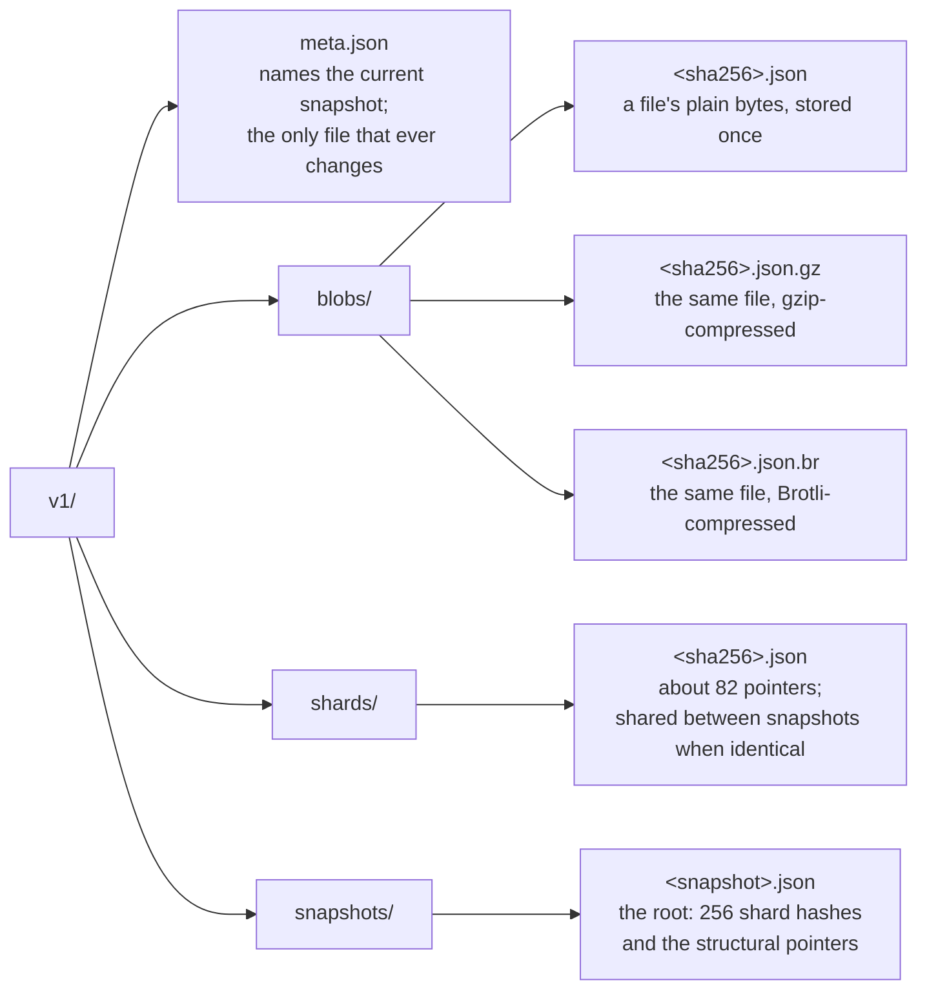
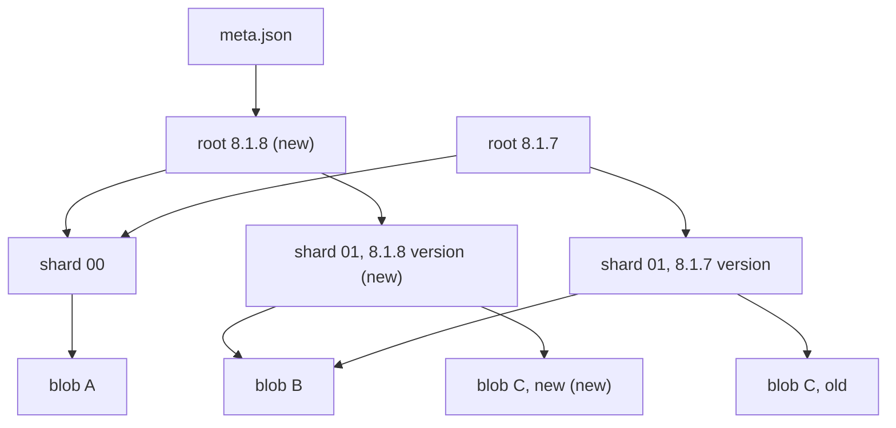

On November 10, 2026, I tried to publish bcd-embed's data for the first time. Both attempts failed. The first ran for six hours before GitHub canceled it. The second stopped after 19 minutes with the error `R2 request exceeded its deadline.`

Diagnosing those failures turned up something more important than the bug itself. The support data for about 97% of features had not changed since the previous BCD release, and I was uploading all of it again. By the end of the day, I had stopped trying to make the upload work and had started a redesign.

This post covers what went wrong, how the cause was found (including a first explanation that turned out to be wrong), and the design that replaces the old one. Along the way, it explains conditional HTTP writes, how a stuck connection pool shows up in a log, and content addressing, which is the idea Git is built on. It assumes you are comfortable with HTTP headers and have a rough idea of what object storage is.

## How bcd-embed publishes data

[browser-compat-data](https://github.com/mdn/browser-compat-data) (BCD) is the dataset behind the browser support tables on MDN. It is distributed as the [`@mdn/browser-compat-data`](https://www.npmjs.com/package/@mdn/browser-compat-data) npm package. bcd-embed serves answers from that dataset through a small JSON API, so that a web component can show a compatibility table for any documented web platform feature on any site.

### The generator, the bucket, and the Worker

The API runs on a [Cloudflare Worker](https://developers.cloudflare.com/workers/), and the Worker does no computation per request. Instead, the work happens ahead of time in three steps:

1. A generator precomputes one JSON file for every BCD feature.
2. A publisher copies those files into a [Cloudflare R2](https://developers.cloudflare.com/r2/) bucket. R2 is Cloudflare's object storage, and each file stored in it is called an _object_.
3. When a request arrives, the Worker reads the ready-made object and returns it.

In this project, _publishing_ means step 2: taking one generated snapshot of BCD and getting it into the bucket.

A snapshot for BCD 8.1.8 holds 20,933 features. Each feature has two files. The normalized file (`features/<key>.json`) is the answer the API gives. The raw file (`raw/<key>.json`) is the untouched BCD entry, for consumers who want to do their own processing. Each of those files is stored three times, as plain JSON, [gzip](https://developer.mozilla.org/en-US/docs/Glossary/gzip_compression), and [Brotli](https://developer.mozilla.org/en-US/docs/Glossary/Brotli_compression), so that nothing is compressed while a request waits.

```
20,933 features × 2 kinds (features, raw) × 3 encodings ≈ 125,600 objects
```

With the index files and `browsers.json` added, the exact total was 125,640 objects, about 570 MB.

Each snapshot lived in its own folder in the bucket, such as `v1/bcd-8.1.8-gen-0.0.0/`. One small file, `v1/meta.json`, names the current snapshot, and the publisher writes it last. Until that final write, a half-uploaded snapshot sits in the bucket with nothing pointing at it. An interrupted upload is therefore never promoted to the live snapshot.

### Conditional writes

Every write the publisher makes is conditional. It sends the HTTP header [`If-None-Match: *`](https://developer.mozilla.org/en-US/docs/Web/HTTP/Reference/Headers/If-None-Match), which asks R2 to store the object only if no object with that name exists yet. R2 answers in one of two ways: it stores the object, or it refuses with [`412 Precondition Failed`](https://developer.mozilla.org/en-US/docs/Web/HTTP/Reference/Status/412). This post calls the second case a _refused write_.

In both cases, the publisher then reads the object back and compares its size and SHA-256 hash with what it meant to upload. This rule has two benefits. A published object can never be silently replaced, and a second run over a half-finished upload continues where the first stopped instead of failing.

The one exception is `v1/meta.json`, which every publication after the first replaces. For that write, the publisher sends `If-Match` with the ETag it last read, so the switch fails if the file changed in the meantime.

## Two runs that did not finish

The two runs failed for different reasons, so it helps to look at them one at a time.

### The first run ran out of time

The [first run](https://github.com/schalkneethling/bcd-embed/actions/runs/42777842228) uploaded four objects at a time until GitHub canceled it at the job's six-hour limit.

Cloudflare's metrics showed why. At about 14,000 writes per hour, all 125,640 objects would have needed about nine hours. About 81,300 were stored when GitHub canceled the job.

The fix looked straightforward. [Pull request 126](https://github.com/schalkneethling/bcd-embed/pull/126) raised the concurrency from 4 to 32 and added a progress line every 5000 objects. The next run would both finish in time and show where it was.

### The second run stalled

The [second run](https://github.com/schalkneethling/bcd-embed/actions/runs/42831899716) failed after 19 minutes and uploaded nothing new.

The 81,300 objects from the first run already existed, so the publisher spent the whole run re-verifying them. For each one, it sent the conditional write, received the 412, and read the object back. It got through about 60,000 of them before it failed with `R2 request exceeded its deadline.`

At this point, a third run was tempting. The publisher is built to pick up where it left off, and a timeout can look like a passing glitch. I decided against that. As I put it at the time: "Instead of just trying over and over again, let's please diagnose the underlying issue." A third run would have spent another 60,000 or so billed writes and as many billed reads. If it failed the same way, I would be no closer to knowing why.

## Finding the cause

The diagnosis used three sources of evidence: the run log, Cloudflare's bucket metrics, and a local reproduction. Each one ruled something out.

### Reading the log and the metrics

For every refused write, the JavaScript S3 SDK, which the publisher uses to talk to R2, printed the warning `An error was encountered in a non-retryable streaming request.` Counting those warnings per second shows exactly when the run slowed down.

| Time (UTC) | Refused writes per second |
| --- | --- |
| 14:26 to 14:39 | about 64 |
| 14:40:55 | about 48 |
| 14:41:14 | about 32 |
| 14:41:21 | 15 |
| 14:41:22 to 14:42:15 | 0 |

For 13 minutes, the rate held steady at about 64 per second. Then, within 30 seconds, it fell to zero. Less than a minute later, a 60-second deadline fired on an upload and the run failed.

That 60-second deadline belongs to the publisher, not to R2. The publisher aborts any request to R2 that takes longer than 60 seconds and throws the exact message from the log.

A steady rate that suddenly collapses looks like throttling, so the next check was Cloudflare's metrics for the bucket that day:

| Metric | Value |
| --- | --- |
| Class A operations (writes) | 141,050 |
| Class B operations (reads) | 142,070 |
| Responses with status 412 | 59,740 |
| Responses with status 429 or 5xx | 0 |

R2 never throttled the publisher, which would have shown up as status 429, and never returned a server error. The 59,740 refusals match the roughly 60,000 objects the second run re-verified. Whatever stopped the run was happening on the publisher's side of the connection, not on R2's side.

### Ruling out large files

The first explanation, which Claude Code proposed, was that a cluster of large files sat at the point where the run stopped and that they were too slow to upload in time. Claude Code then checked this against the manifest, and the manifest disproved it. There was no cluster of large files near the failure point, and files as large as 876 KB had passed earlier in the same run. File size alone could not explain a run that handled large files at full speed for about 13 minutes and then stopped.

Size still turned out to matter, but in a different way.

### Reproducing the stall locally

The publisher sends each file to R2 as a stream read from disk ([`createReadStream`](https://nodejs.org/api/fs.html#fscreatereadstreampath-options)). It sends the stream through the [JavaScript S3 SDK](https://github.com/aws/aws-sdk-js-v3). S3 is Amazon's object storage API, and R2 accepts the same API.

On a rerun, every one of those writes is refused. A server can refuse a conditional write by looking at the request headers alone, before it has read the body. That is the case the local reproduction tested.

The reproduction ran the same client against a fake S3 server on a local machine. The server refused each streamed upload from its headers, without reading the body. With a small body, every request completed. With a large body, the request never completed, and its socket was never returned to the client's connection pool.

A connection pool is a fixed set of open network connections (sockets) that requests take turns using. The S3 client's pool holds 50 sockets by default. A request checks out a socket, uses it, and returns it. The following table shows how many sockets were left checked out, and never returned, at each body size:

| Body size | Sockets left checked out |
| --- | --- |
| 2 KB | 0 |
| 16 KB | 0 |
| 40 KB | 0 |
| 70 KB | 27 of 120 requests |
| 100 KB | 33 |
| 200 KB | pool filled to 50; the test hung |
| 400 KB | pool filled to 50; the test hung |

Sending the same files as in-memory buffers instead of streams left no socket checked out at any size up to 3 MB.

That result matches the shape of the log. Think of the pool as a switchboard with 50 phone lines shared by 32 callers. A normal call ends and frees its line. A stuck call never hangs up, so its line stays busy for good. In the local test, a stuck socket stayed busy until the test ended, and in the real run, until the run failed. The publisher had 32 workers and 50 sockets, so it started with 18 spare lines. The first 18 stuck calls cost nothing, because every worker could still get a line. From the 19th stuck call onward, some workers had to wait, and throughput fell.

The numbers line up with that picture. At full speed, 32 workers handled 64 objects per second, which is 2 per worker:

| Stuck sockets | Workers with a socket | Objects per second | Time |
| --- | --- | --- | --- |
| 0 to 18 | 32 | about 64 | steady |
| about 26 | about 24 | about 48 | 14:40:55 |
| about 34 | about 16 | about 32 | 14:41:14 |
| 50 | 0 | 0 | from 14:41:22 |

Once all 50 sockets were stuck, no socket was free, and every new request waited until the 60-second deadline aborted it.

### What remains unproven

This mechanism is reproduced locally, but it is not proven against R2 itself. Only about one in ten of the run's larger objects would have had to get stuck to fill the pool. That fits a fault that depends on timing, such as whether R2's refusal arrives before or after the body has been sent. That fit is an inference, not a measurement.

The new design avoids the pattern either way, because it sends buffers instead of streams and makes refused writes rare. The first publication, on November 14, 2026, uploaded 122,312 objects this way without a stall. That supports the diagnosis, but it does not prove it. The publisher does not yet log the state of its connection pool, so if this happens again, it would still have to be inferred from a rate.

## Only about 3% of the data changes

The diagnosis explained why the second run stopped. It did not answer a better question: why did a weekly data update need 125,640 uploads at all?

The repository already contained the answer. [Dependabot](https://docs.github.com/en/code-security/dependabot), GitHub's dependency update bot, opens a pull request whenever a new BCD version is released. A freshness workflow then generates the API's output for both the old and the new BCD version and compares them in a diff report. The reports show how little changes:

| Update | Added | Removed | Changed | Share of the newer release's features |
| --- | --- | --- | --- | --- |
| 8.1.7 to 8.1.8 (one release) | 35 | 0 | 557 | 2.8% |
| 8.1.3 to 8.1.7 (four releases) | 366 | 115 | 892 | 6.6% |

The system computed this to decide whether a release was safe to publish, and then uploaded everything anyway. Or, in the words I used that afternoon: "Seems wasteful to blow away 100,000+ records every week."

Two design choices forced the full upload. The first was in the file bodies, and the second was in the bucket layout.

### Release fields in every file

Every normalized file started like the following example. The comments mark which fields change and how often:

```jsonc
{
  "contract": "1.0.0",
  "generated": "2026-11-09T22:19:15Z", // changes on every release
  "source": { "package": "@mdn/browser-compat-data", "version": "8.1.8" }, // changes on every release
  "query": "css.properties.height.fit-content",
  "browsers": {}, // changes rarely
  "features": [], // changes only when BCD's data for this feature changes
}
```

The `generated` timestamp and the `source` version differ on every release. As a result, all 20,933 normalized files differed byte for byte from the previous release, even when the support data was identical. The `raw/` files have no such fields, so they were already identical whenever BCD's entry had not changed.

### A folder per snapshot

Each snapshot was a folder with its own copy of every file, and the Worker read `v1/<snapshot>/features/<key>.json`. A new snapshot therefore needed every file under a new name. That included the `raw/` files, whose bytes had not changed at all.

## The content-addressed design

The new design, first written up as a proposal in [pull request 131](https://github.com/schalkneethling/bcd-embed/pull/131), changes both of those choices. I decided to adopt it the same day. The design has four parts: naming files by their content, a way to find those files again, a structure that keeps changes small, and a new publication flow.

### Naming a file by its content

A SHA-256 hash turns any sequence of bytes into a 64-character name. The same bytes always produce the same name, and changing a single byte produces a completely different one:

```
{"version_added":"66"}  →  3ae8633b2c77eeee8c14dcec5b3563ebd8ea421a894a62097d64c6f067695209
{"version_added":"67"}  →  bc0ea563458b8ae3ac4157148e0b6bb60f5fef42c5b6d109893434e7161c9743
```

The two inputs differ by one character, and the two hashes have nothing in common.

> **Try it out:** You can produce these hashes yourself with Node.js. Save the following code as `hash.mjs` and run `node hash.mjs`.

```js
import { createHash } from "node:crypto";

function sha256(text) {
  return createHash("sha256").update(text).digest("hex");
}

console.log(sha256('{"version_added":"66"}'));
console.log(sha256('{"version_added":"67"}'));
```

The output matches the two hashes in the previous example. Try changing a single character in either string, or add a space, and run it again. The whole hash changes.

Now suppose the publisher stores every file under the hash of its own bytes. A file that did not change between two releases has the same name in both. The publisher finds that name already in the bucket and has nothing to upload. A file that did change gets a new name and is uploaded once. This technique is called _content addressing_, and a file stored this way is called a _blob_.

Take `raw/css.properties.gap.json` as an example. If BCD's entry for `gap` is identical in 8.1.7 and 8.1.8, the bytes are identical, so the hash is identical. The 8.1.8 snapshot reuses the blob that 8.1.7 already uploaded. Under the old layout, the same unchanged bytes would have been uploaded again as `v1/bcd-8.1.8-gen-0.0.0/raw/css.properties.gap.json`.

Content addressing only saves uploads if unchanged support data produces unchanged bytes. That is why `generated` and `source` move out of the response body. They become response headers instead, with the names `bcd-embed-generated`, `bcd-embed-source-version`, and `bcd-embed-snapshot`. They also stay in `meta.json` for anyone who wants them as data.

### Pointers, shards, and a root

Nobody can predict a blob's name, so the Worker needs a way to get from a request for `css.properties.gap` in snapshot 8.1.8 to the right blob. That is the job of a _pointer_: a record that says "in this snapshot, this request path is answered by blob `<hash>`."

A snapshot has more than 20,000 features, so its pointers are split into 256 small files called _shards_. A key's shard is chosen by the first byte of the SHA-256 hash of the key. For `css.properties.gap`, the hash begins with `0a`, which is 10 in decimal, so its pointer lives in shard 10. Hashing spreads the keys roughly evenly, to about 82 keys and roughly 16 KB per shard.

> **Note:** The value that is hashed is the UTF-8 bytes of the key, exactly as written. The generator and the Worker both compute the shard this way, and the Worker's tests serve a tree that the real generator produced, which checks that the two agree.

Finally, each snapshot gets one _root_ file. The root lists the hashes of the snapshot's 256 shards, plus pointers for the handful of files that do not belong to a single feature, such as `browsers.json` and the index files. Shards are stored under the hash of their content, just like blobs. The root is the exception. It is stored under the snapshot's name, `v1/snapshots/<snapshot>.json`, so that the Worker can find it from the snapshot name that `meta.json` or a pinned URL gives it.

The following tree shows the bucket layout:



The `<sha256>` in all three blob names is the hash of the plain bytes. That way, one pointer finds all three encodings.

### Why each level names the one below by hash

A shard names its blobs by hash, so a shard's own bytes change only if one of its blobs changed or a pointer was added or removed. The root names its shards and the structural files by hash, so the root changes only if a shard or one of those files changed. A change at the bottom therefore produces new objects only along the path from that blob up to the root. Everything else is shared with the previous snapshot.

The following diagram shows two snapshots, 8.1.7 and 8.1.8, when exactly one feature changes between them. An arrow means "points to," and objects marked "(new)" are the only ones the 8.1.8 publication uploads:



The new snapshot needed three new objects: the changed blob, the one shard that points to it, and a new root. Shard 00, blob A, and blob B are the same objects the old snapshot uses. A structure in which each level names the level below by its hash is called a _[Merkle tree](https://en.wikipedia.org/wiki/Merkle_tree)_. Git stores commits, directories, and files the same way.

One more property follows from this. The root's hash depends on every shard hash, and every shard hash depends on its blob hashes. The root's hash therefore identifies the entire snapshot, even though it is not the root file's name. That hash is what a reviewer approves, in place of the digests the review used before.

### How a publication runs

Under the old design, a publication took two workflow runs. The first produced digests (hashes that summarize the snapshot) for a person to review and approve. The second published. Each run downloaded the whole live snapshot to compare against. The new publisher replaces that download with a much smaller comparison:

1. Hash every file in the candidate snapshot locally.
2. Read the live snapshot's root and shards from R2. This is at most 257 reads: one root and 256 shards.
3. Compare the two sets of pointers. The comparison produces both the list of blobs to upload and the diff report for the review.
4. Upload each missing blob from an in-memory buffer, still with a conditional write and a read-back, followed by the new shards and the root.
5. Check again that the snapshot matches what the reviewer approved, and then switch `v1/meta.json`, exactly as the old publisher did.

An interrupted run leaves blobs that nothing points to yet, and a rerun finds them and continues. Nothing is live until `meta.json` changes.

## Costs and savings

R2 bills two classes of operation: Class A covers writes and listings, and Class B covers reads. According to [Cloudflare's R2 pricing page](https://developers.cloudflare.com/r2/pricing/), each month includes 10 GB of storage, 1,000,000 Class A operations, and 10,000,000 Class B operations for free. Beyond that, Class A costs $4.50 per million, Class B costs $0.36 per million, and storage costs $0.015 per GB-month. A write that R2 refuses with a 412 is still billed as a Class A operation. R2 is also not yet covered by Cloudflare's new [spending limits](https://blog.cloudflare.com/spend-management), which launched in beta for Workers and Durable Objects only.

The following table compares one publication under each design. The "New design" column is an estimate derived from the diff reports, not a measurement:

| Per publication | Old design | New design (estimate) |
| --- | --- | --- |
| Class A (writes) | 125,640 | about 3900: 3600 blobs, 256 shards, a root |
| Class B (reads) | about 377,000 | about 4200 |
| Storage added | 0.57 GB | about 20 MB |
| Cost of a rerun | up to 125,640 writes | the same writes again; R2 refuses the ones already stored but still bills them |

The read figure for the old design counts one read-back per object, plus downloading the live snapshot twice, once in each of the two workflow runs. That figure was counted from the code, not measured.

BCD releases about weekly, which averages about 4.3 publications a month. At that rate, the difference looks like this:

| Per month | Old design | New design (estimate) | Free allowance |
| --- | --- | --- | --- |
| Class A (writes) | about 540,000 (54%) | about 17,000 (2%) | 1,000,000 |

The old design fit inside the free allowance, but only with room for about 3.7 wasted full passes a month. After that, every further write was billed.

The estimate had a known weak point. The diff report counts features whose _meaning_ changed, but a blob changes whenever any _byte_ changes. If a block that every feature file repeats, such as `browsers`, changes in a release, every normalized file changes with it. The first implementation step was therefore a measurement: generate real 8.1.7 and 8.1.8 snapshots without the release fields, and count the identical files and the changed shards. The threshold for going ahead was 90% identical files.

The result was 97.6%. Of the 41,880 files in 8.1.8, 40,871 are byte-identical to 8.1.7, 939 changed, and 70 are new. Those 1009 files need only 972 new blobs, because some of them have content that is already stored. With each blob stored in three encodings, plus 241 shards and one root, that is 3158 writes, where the estimate was about 3900. Two numbers were worse than expected. The new objects add about 55.5 MB of storage, where the estimate was about 20 MB. And because a changed pointer changes its shard, and the changed features are spread across almost all of them, 241 of the 256 shards are rewritten.

## Trade-offs

The new design is not free. It costs extra work per request, makes cleanup riskier, and delayed the first deployment.

The Worker's request path gains two lookups. To answer a request, the Worker now reads `meta.json`, the root, the shard, and the blob. Roots and shards never change once written, so the Worker can keep them in memory and in Cloudflare's cache indefinitely. A request that finds both cached costs the same two R2 reads as the old design: `meta.json` and the blob. A request that finds neither costs four.

Removing old data becomes harder and riskier. The old publisher deleted an expired snapshot's folder. With shared blobs, a blob from an expired snapshot may still be used by a live one. Cleanup becomes _mark and sweep_. The cleanup reads every live root and shard to build the set of hashes still in use (the mark), then lists the bucket and deletes only objects that are unused and older than a seven-day grace period (the sweep). The grace period protects blobs that a publication in progress has uploaded but not yet pointed to. A bug here could delete data that a live snapshot needs, so the cleanup has a dry-run mode that deletes nothing and reports how many blobs, shards, and roots a real run would delete. It is an option in the code, not yet a switch on the publish command.

The first deployment was delayed. The contract (the documented shape of every API response), the generator, the publisher, and the Worker all had to change before anything went live.

I also abandoned the half-finished upload. Finishing it would have cost about 44,000 writes for new objects, plus a refused but still billed write for each of the roughly 81,000 objects already in place, all for a layout the new design replaces. Those objects were deleted on November 15, 2026. The count was 81,468, and a second listing of the folder found none left.

To make sure overspending is noticed early, the Cloudflare account now has usage alerts for writes, reads, and storage, each set below its free allowance. The alerts send a warning, but they do not stop usage. The publisher also prints its own count of operations at the end of every run, grouped the way R2 bills them: writes and listings together, reads, and deletes.

## What changes for the project and its users

For the project, the redesign matters more than the bug fix. The stuck connections are a client-side fault, and sending buffers instead of streams avoids it. The full upload, on the other hand, was a design choice. It used most of the free write allowance every month, made every retry cost a full pass, and tied the length of every publication to the size of the dataset instead of the size of the change. As I said at the time, "From an architecture perspective this is simply better design."

For people who will use the API, most things stay the same. Request URLs do not change, pinned snapshot URLs still work, and snapshots that are no longer current are still kept for 90 days.

Two things change. The first is a breaking change: a response no longer contains `generated` and `source`. Consumers read the release's identity from the three response headers instead, or from `meta.json`. The headers are added to [`access-control-expose-headers`](https://developer.mozilla.org/en-US/docs/Web/HTTP/Reference/Headers/Access-Control-Expose-Headers) so that browser scripts can read them. Contract 1.0.0 promised that every response includes `source.version`, so this breaks that promise. Because nothing has been published and nobody consumes the API yet, 1.0.0 was changed in place instead of introducing a second contract version.

The second change benefits consumers. A response's [`ETag`](https://developer.mozilla.org/en-US/docs/Web/HTTP/Reference/Headers/ETag) is the hash of its bytes. Under the old design, those bytes changed on every release, so every release invalidated every cached response for every consumer. With the release fields out of the body, a feature that did not change keeps its `ETag` across BCD releases. A consumer that revalidates its cached copy receives a [`304 Not Modified`](https://developer.mozilla.org/en-US/docs/Web/HTTP/Reference/Status/304) response with no body.

## Wrapping up

The idea worth taking away is that the system already knew how little had changed, and the storage design ignored it. Two decisions that each looked harmless, a timestamp inside every file and a folder per snapshot, turned a 3% change into a 100% upload.

A few traps along the way are worth restating. A third run was the tempting next step, even though the evidence that explained the failure was already in the log and the metrics. The first explanation, a cluster of large files, was wrong, and the manifest showed it. The explanation that replaced it is reproduced locally but not proven against R2. And the cost figures for the new design were estimates until the measurement was done. It put a routine release at 3158 writes, below the estimate of about 3900. That figure comes from comparing two snapshots on disk. As of November 19, 2026, only the first publication has run against R2, so I have not yet measured an update from one release to the next in production.

The measurement passed its threshold, and the design went ahead as proposed. The first publication, which made BCD 8.1.9 current, ran on November 14, 2026, and the API has served from the new layout since November 15.

**How this work was done:** I did this work together with Claude Code. I asked the questions and made the decisions. Claude Code did much of the investigation, wrote much of the code, and helped draft this post.

## See also

- [Document 8: Incremental publication](https://github.com/schalkneethling/bcd-embed/pull/131): the original proposal for the content-addressed design, including the implementation sequence
- [How publication works](https://github.com/schalkneethling/bcd-embed/blob/main/apps/website/src/content/docs/publication.md): how publication works today, with diagrams
- [`If-None-Match`](https://developer.mozilla.org/en-US/docs/Web/HTTP/Reference/Headers/If-None-Match) on MDN: the header behind the publisher's conditional writes of immutable objects, and the header a browser sends when it revalidates a cached `ETag`
- [R2 pricing](https://developers.cloudflare.com/r2/pricing/) on Cloudflare Docs: the free allowances and per-operation prices used in this post
- [Git internals: Git objects](https://git-scm.com/book/en/v2/Git-Internals-Git-Objects) in Pro Git (2014): a hands-on explanation of how Git names content by its hash, the same idea at a smaller scale
